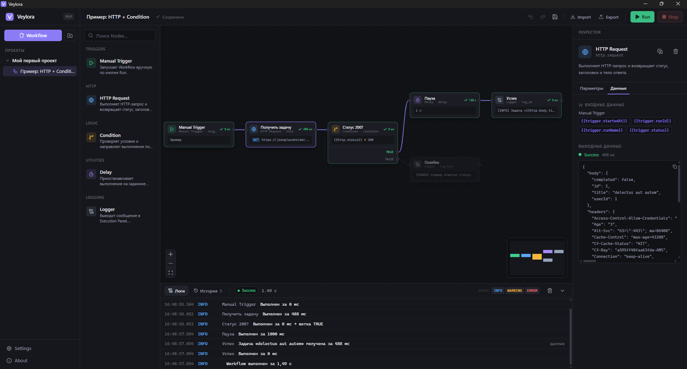

<p align="center">
  
</p>

<h1 align="center">Veylora</h1>

<p align="center">
  Локальное desktop-приложение для визуального создания и выполнения автоматизаций.<br/>
  Без регистрации, облака и сторонних серверов.
</p>

<p align="center">
  <a href="LICENSE"></a>
  
  
  
  
</p>



## Что умеет

Соберите сценарий из блоков (Nodes) на холсте, соедините их линиями, настройте параметры и нажмите **Run**. Движок на Go выполнит граф, передаст данные между блоками и покажет результат каждого шага в реальном времени.

- **Визуальный редактор**: drag & drop, соединение портов, multi-select, мини-карта, масштабирование, Undo/Redo.
- **5 типов Nodes**: Manual Trigger, HTTP Request, Condition (ветки TRUE/FALSE), Delay, Logger.
- **Переменные между шагами**: `{{http.status}}`, `{{http.body.items.0.name}}`.
- **Живое выполнение**: статусы `WAITING → RUNNING → SUCCESS / FAILED / SKIPPED / CANCELLED`, подсветка пройденного пути, логи, история запусков.
- **Остановка в любой момент**: Stop прерывает даже долгий Delay или HTTP-запрос.
- **Валидация до запуска**: циклы, несовместимые порты, пустые обязательные поля, неверные URL. Некорректный Workflow не запустится.
- **Автосохранение** в локальную базу SQLite.
- **Импорт и экспорт** в JSON с проверкой версии схемы. Токены и пароли в экспорт не попадают.

## Установка

Скачайте последнюю версию со страницы [Releases](../../releases):

- `Veylora-…-setup.exe` — установщик (если нужно, ставит WebView2);
- `Veylora-…-portable.exe` — работает без установки.

Нужна Windows 10/11 и Microsoft Edge WebView2 (в Windows 11 он уже есть).

При первом запуске создаётся проект с примером. Откройте его и нажмите **Run**.

## Горячие клавиши

| Действие | Клавиши |
| --- | --- |
| Сохранить | <kbd>Ctrl</kbd>+<kbd>S</kbd> |
| Запустить | <kbd>Ctrl</kbd>+<kbd>Enter</kbd> |
| Отменить / повторить | <kbd>Ctrl</kbd>+<kbd>Z</kbd> / <kbd>Ctrl</kbd>+<kbd>Shift</kbd>+<kbd>Z</kbd> |
| Дублировать Node | <kbd>Ctrl</kbd>+<kbd>D</kbd> |
| Удалить выделенное | <kbd>Delete</kbd> |
| Выделение рамкой | <kbd>Shift</kbd> + перетаскивание |
| Добавить к выделению | <kbd>Ctrl</kbd> + клик |

## Nodes

| Node | Что делает | Выход (`{{key.…}}`) |
| --- | --- | --- |
| **Manual Trigger** | Стартовая точка, запускается кнопкой Run | `startedAt`, `runId`, `runName`, `status` |
| **HTTP Request** | GET / POST / PUT / PATCH / DELETE с заголовками, query, телом и таймаутом | `status`, `headers`, `body`, `timeMs`, `size` |
| **Condition** | Equals, Not Equals, Greater Than, Less Than, Contains, Is Empty | `result`; выполнение идёт по порту TRUE или FALSE |
| **Delay** | Пауза в мс / с / мин (до 60 минут), прерывается по Stop | `waitedMs` |
| **Logger** | Сообщение уровня INFO / WARNING / ERROR / DEBUG в Execution Panel | `message`, `level`, `variables` |

Результат каждого Node публикуется под его **именем переменной** (поле *Имя переменной* в Inspector). Если HTTP Request называется `http`, следующие Nodes могут использовать `{{http.status}}` или `{{http.body.message}}`. Если поле целиком состоит из одной переменной, значение сохраняет тип: Condition сравнивает `{{http.status}}` с `200` как числа.

## Безопасность

- Приложение не выполняет команды ОС.
- HTTP Request принимает только `http://` и `https://`, поэтому чтение локальных файлов через `file://` невозможно.
- По умолчанию запросы к `localhost` и частным сетям (`127.0.0.0/8`, `10.0.0.0/8`, `192.168.0.0/16`, `169.254.0.0/16` и т. п.) заблокированы. Адрес проверяется после DNS-резолва, что защищает и от DNS rebinding, и от редиректов. Разрешить такие запросы можно в **Settings**.
- Ограничения: таймаут запроса до 120 с, размер ответа до 5 МБ (меняется в Settings до 50 МБ), не больше 5 редиректов, Delay до 60 минут, не больше 5000 строк лога на запуск.
- Значения заголовков вроде `Authorization`, `X-API-Key`, `Cookie`, а также токены и пароли в URL маскируются (`••••••`) в логах, ошибках и выводе.
- При экспорте такие значения удаляются. Файл содержит список вычищенных полей, а при импорте приложение напомнит заполнить их заново.
- При закрытии приложения текущий запуск корректно отменяется и сохраняется в истории со статусом `CANCELLED`.

> В MVP секреты хранятся в локальной базе данных в открытом виде (в профиле пользователя). Шифрование хранилища запланировано.

## Где лежат данные

`%APPDATA%\Veylora\`:

- `veylora.db` — база SQLite: проекты, Workflow, история запусков, настройки. Её можно открыть расширением *SQLite* для VS Code;
- `logs\veylora.log` — структурированный JSON-журнал для диагностики (без секретов).

Путь можно переопределить переменной окружения `VEYLORA_DATA_DIR`.

## Разработка

### Требования

- [Go 1.24+](https://go.dev/dl/)
- [Node.js 22+](https://nodejs.org/)
- Wails CLI: `go install github.com/wailsapp/wails/v2/cmd/wails@v2.17.1`
- (для установщика) [NSIS](https://nsis.sourceforge.io/): `winget install NSIS.NSIS`

Проверить окружение: `wails doctor`.

### Команды

```bash
wails dev                       # приложение с hot reload
wails build                     # build/bin/Veylora.exe
wails build -nsis               # + установщик build/bin/Veylora-amd64-installer.exe

go test ./internal/...          # тесты Go (движок, Nodes, валидация, хранилище, импорт/экспорт)

cd frontend
npm run lint                    # ESLint
npm run typecheck               # TypeScript
npm run format                  # Prettier
```

> Используйте `go test ./internal/...`, а не `./...`: в `frontend/node_modules` встречаются чужие `.go`-файлы.

Сгенерированные Wails-обёртки лежат в `frontend/src/wailsjs/` и обновляются автоматически при `wails dev` и `wails build`. Вручную их не правьте.

### Структура

```
veylora/
├── main.go                 # точка входа (Wails собирает корень модуля, поэтому не cmd/)
├── internal/
│   ├── app/                # Wails-биндинги, запуск окна, связка всех слоёв
│   ├── engine/             # исполнитель графа и менеджер запусков (Stop, Shutdown)
│   ├── nodes/              # описания и реализации Nodes
│   ├── execution/          # контекст переменных, шаблоны {{…}}, маскирование секретов
│   ├── workflow/           # модель документа, импорт/экспорт
│   ├── validation/         # проверка графа и параметров, топологическая сортировка
│   ├── storage/            # SQLite: миграции и репозитории
│   └── events/             # события Go → GUI и статусы
├── frontend/src/
│   ├── panels/             # Sidebar, Topbar, NodeLibrary, Canvas, Inspector, ExecutionPanel
│   ├── nodes/              # компонент Node на холсте
│   ├── stores/             # Zustand: workspace, editor, run, ui
│   ├── hooks/              # события движка, автосохранение, валидация, горячие клавиши
│   ├── services/           # обёртки над Wails API и событиями
│   └── components/         # UI-примитивы, диалоги
├── examples/               # примеры Workflow для импорта
├── docs/                   # архитектура
└── build/                  # иконки и манифест Windows, установщик NSIS
```

Как устроен движок, описано в [docs/ARCHITECTURE.md](docs/ARCHITECTURE.md).

### Как добавить новый Node

1. Создайте файл в `internal/nodes/` с типом, реализующим интерфейс `Executor` (`Definition`, `Validate`, `Execute`).
2. Зарегистрируйте его в `NewRegistry()` (`internal/nodes/registry.go`).
3. При необходимости добавьте иконку в `frontend/src/components/icons.tsx` и краткое описание в `Summary` (`frontend/src/nodes/VeyloraNode.tsx`).

Inspector строит форму по `Definition.Params`, так что отдельный UI писать не нужно.

## Релиз

```bash
git tag v0.1.0
git push origin v0.1.0
```

GitHub Actions соберёт установщик и portable-версию и создаст черновик релиза.

## Лицензия

[MIT](LICENSE)
